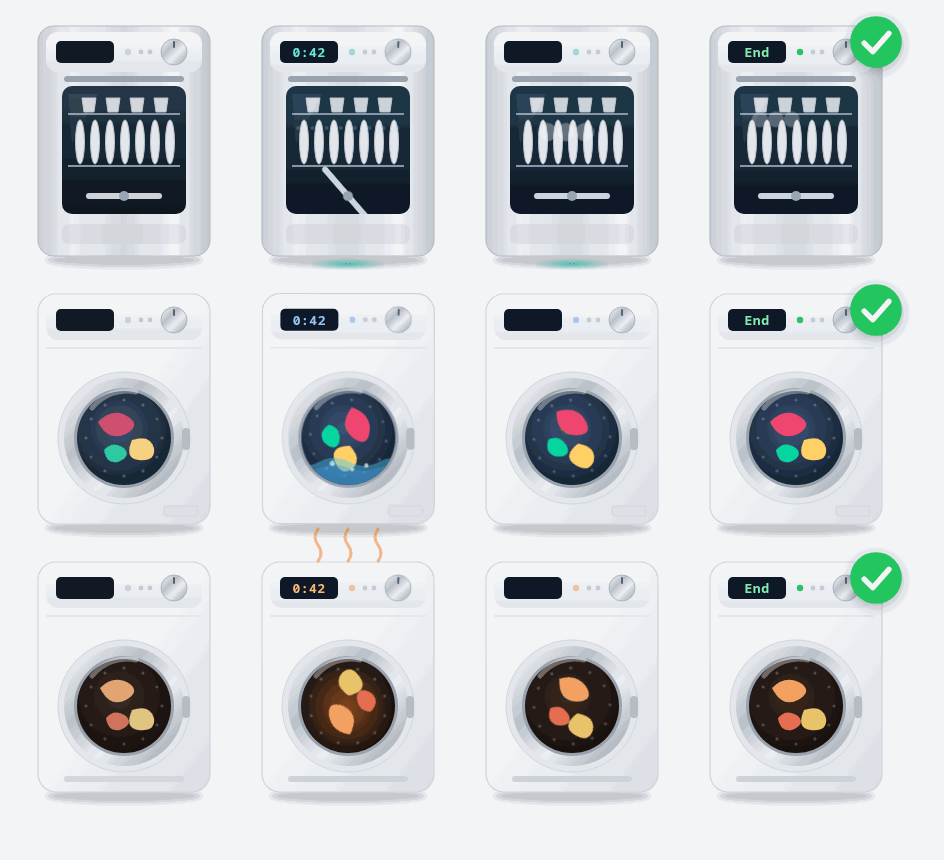
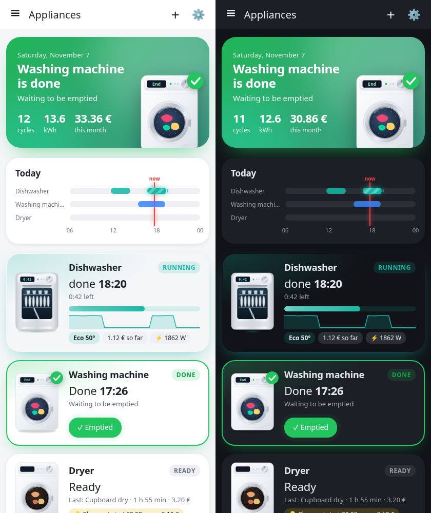
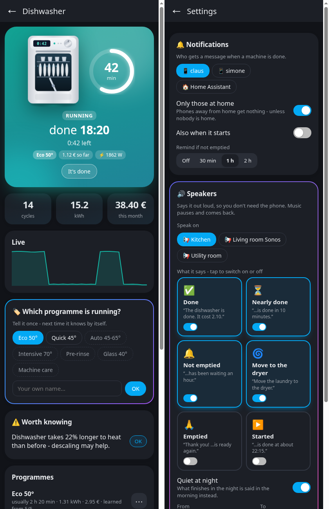
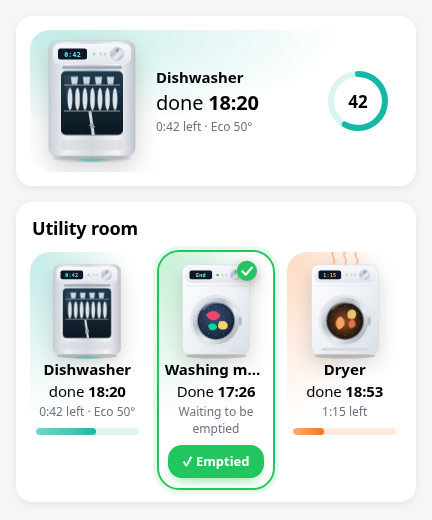
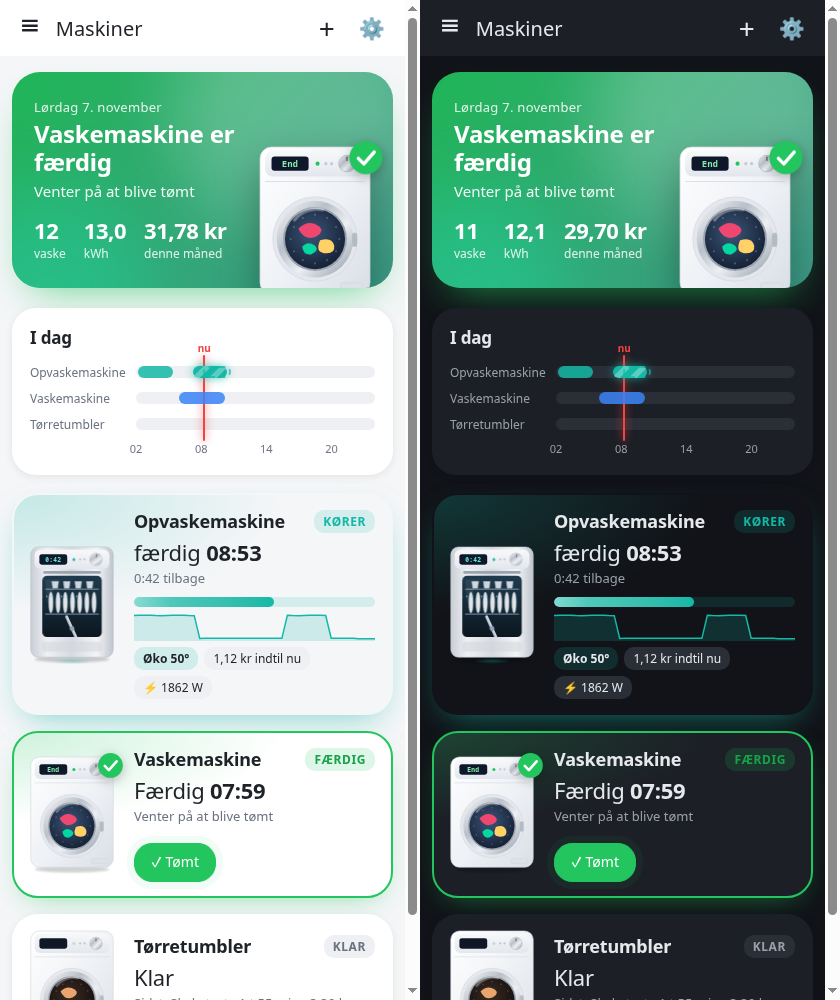

# Appliance Watch

**Knows when your dishwasher, washing machine and dryer are *really* done** – from what the machine does, not from a clock.

Most "is it done?" integrations wait for a learned duration or for 0 W. A dishwasher that dries at 5–15 W for half an
hour is then "running" long after it finished. Appliance Watch says done when the work is over (no heating, no pump,
no motor) and the machine has only rested longer than its own programme ever pauses.

## What it does

- **Done when it's done** – learns the pauses of each programme, so a long eco programme isn't called done in a pause,
  and a quick one is called done within minutes. A door sensor makes it instant.
- **Never learns from its own mistakes** – only cycles that ended clearly are learned from. If it ever starts again
  after "done", the pause is learned and you get a correction.
- **Programmes** – say once "that was Eco 50°", and it recognises it next time within the first minutes.
- **Done at 14:35** – time left gets more exact while it runs (by time *and* energy used).
- **Price** – what each cycle cost, and when starting would be cheaper (Strømligning, Nord Pool, Energi Data Service…).
- **Wear and faults** – "takes 20 % longer to heat than before – descale it", "stopped far earlier than usual",
  "has run unusually long".
- **Notifications** – to whoever is home, with an *Emptied ✓* button, a reminder if nobody empties it, and
  "move the laundry to the dryer".
- **Speakers** – says it out loud: done, nearly done, not emptied, move to the dryer, emptied, started – each on or off.
  Music pauses and comes back, quiet at night (said in the morning instead), only when someone is home.
- **Learns from your history** – a new machine learns its programmes from the power history Home Assistant already
  has, so it's good from day one.
- **Your month at a glance** – cycles, kWh and cost this month, a timeline of today, and a live power curve while it
  runs.
- **Assist** – "when is the dishwasher done?"
- **AI helper (optional)** – names programmes and explains odd cycles. It never measures anything.
- **Finds your machines** – power sensors named like a dishwasher, washing machine or dryer show up as discovered.

## The panel and the card

Every machine drawn as itself and animated while it runs – the drum turns, water sloshes, a dryer glows, a dishwasher
sprays and steams. The card comes with the integration: *Add card → Appliance Watch*, pick one machine or show them all.

## Install

HACS → ⋮ → Custom repositories → `https://github.com/Clahen86/appliance-watch` (Integration) → install → restart.
Then *Settings → Devices & services*: your machines are discovered, or *Add integration → Appliance Watch*.
You need a smart plug that measures power (W) on each machine.

---

## Dansk

**Ved hvornår opvaskeren, vaskemaskinen og tørretumbleren *virkelig* er færdige** – ud fra hvad maskinen gør, ikke et ur.

- **Færdig når den er færdig** – lærer pauserne i hvert program; en dørsensor gør det øjeblikkeligt.
- **Lærer aldrig af sine egne fejl** – kun vaske med en tydelig slutning bruges.
- **Programmer** – sig én gang "det var Øko 50°", så kender den det næste gang.
- **Færdig kl. 14:35**, **pris pr. vask** og **billigste starttidspunkt**.
- **Slid og fejl** – fx "afkalk den" eller "stoppede meget tidligere end normalt".
- **Besked** til den der er hjemme, med *Tømt ✓*, påmindelse og "flyt tøjet til tørretumbleren".
- **Højttalere** – siger det højt (færdig, snart færdig, ikke tømt, flyt til tørretumbleren …), stille om natten.
- **Lærer fra historikken** – en ny maskine lærer sine programmer ud fra den historik, Home Assistant allerede har.
- **Månedens tal**, tidslinje for i dag og live-kurve, mens den kører.
- **Assist** – "hvornår er opvaskeren færdig?"
- **Panel og kort** med animerede maskiner.

